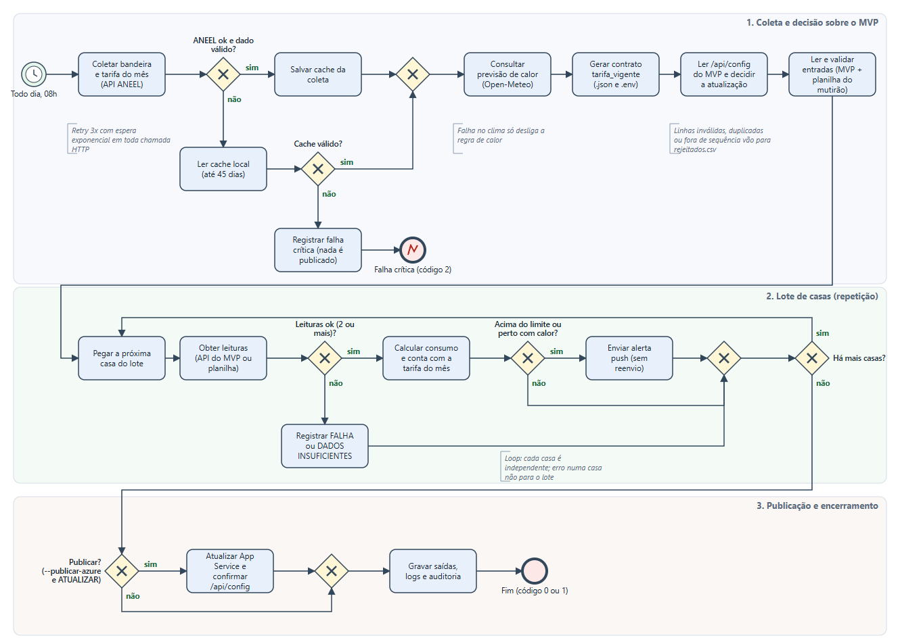

# Conta Clara: Robô mensal de tarifa, estimativa e alertas (RPA)

Global Solution FIAP 2026.2 (CitizenTech), 4ES. Entrega de **Robotic Process Automation: Do Processo Manual à Automação Inteligente**.

[](../../actions/workflows/robo-mensal.yml)

O **Conta Clara** ajuda famílias de baixa renda a entender a conta de luz. A família anota o número do medidor, vê quanto a conta deve dar e confere se a distribuidora cobrou certo. Este robô roda sozinho **todo dia às 08h** (GitHub Actions) e faz, sem ninguém, o trabalho que antes era manual nos bastidores:

1. busca a **bandeira tarifária** e a **tarifa B1 residencial** da Enel SP nos **dados abertos da ANEEL**;
2. gera os valores `TARIFA_KWH` e `BANDEIRA` que o **MVP** usa e decide se ele precisa ser atualizado (com opção de publicar e confirmar no App Service);
3. recalcula a **conta estimada de cada casa**, tanto das casas do MVP (pela API) quanto das famílias sem celular atendidas no **mutirão do CRAS** (por planilha);
4. **dispara alerta** (push pelo ntfy.sh) quando a conta passa do limite da família ou chega perto dele com onda de calor prevista (Open-Meteo);
5. registra tudo em **logs e trilha de auditoria**, sem dado pessoal.

| | |
|---|---|
| **MVP** | https://contaclara-gs.azurewebsites.net (repositório: https://github.com/ph-tavares/conta-clara) |
| **Vídeo** | https://youtu.be/SOYqpsIRzj4 |
| **Relatório (PDF)** | [`docs/relatorio-rpa.pdf`](docs/relatorio-rpa.pdf) |
| **Processo (BPMN e PDD)** | [`docs/processo.bpmn`](docs/processo.bpmn), [`docs/PDD.md`](docs/PDD.md) |

### Integrante

| Nome completo | RM |
|---|---|
| Pedro Henrique Pedrosa Tavares | RM97877 |

## Arquitetura



```
                 ┌────────────────────── GitHub Actions (cron: todo dia, 08h) ───────────────────────┐
                 │                                                                                   │
 API ANEEL ──────┤                                                                                   │
 (bandeira,      │   src/executar.py ─► robo.py ─► fontes.py   (coleta + cache + trava de sanidade)  │
  tarifas)       │                         │      entrada.py  (validação, duplicatas, sequência)     │
 Open-Meteo ─────┤                         │      regras.py   (tributos, estimativa, decisão)        │
 MVP /api/* ─────┤                         │      mvp.py      (API do MVP + publicação az opcional)  │
 planilha CRAS ──┤                         │      alertas.py  (ntfy, sem reenvio)                    │
                 │                         └────► auditoria.py (log + JSONL, mascaramento)           │
                 └───────────────────────────────────────────┬───────────────────────────────────────┘
                                                             ▼
         saida/AAAA-MM/tarifa_vigente.json|.env ──► MVP (TARIFA_KWH, BANDEIRA ─► /api/config ─► tela)
         saida/AAAA-MM/estimativas.csv, alertas.json, rejeitados.csv, resumo_execucao.json
         logs/robo-<id>.log, logs/auditoria.jsonl            push ntfy.sh ─► celular do agente/família
```

| Pasta | Conteúdo |
|---|---|
| `src/` | código Python (só biblioteca padrão; Python 3.10 ou mais novo) |
| `config/config.json` | URLs, distribuidora, faixas de ICMS, limites (nenhum segredo) |
| `entrada/` | casas do MVP acompanhadas e planilha do mutirão (dados **sintéticos**) |
| `saida/` | resultados de cada competência (`simulacoes/` = execuções de teste de falha) |
| `logs/` | amostras reais de logs e a trilha `auditoria.jsonl` |
| `docs/` | BPMN, PDD, relatório e roteiro do vídeo |
| `assets/` | prints das execuções e diagrama |
| `tests/` | testes automatizados e [descrição dos cenários](tests/README.md) |
| `integracao-mvp/` | [contrato com o MVP e como ligar](integracao-mvp/README.md) |
| `.github/workflows/` | agendamento diário (com estado guardado entre execuções) + testes a cada push |

## Como rodar

Pré-requisito: Python 3.10 ou mais novo. **Não há dependências para instalar.**

```bash
git clone https://github.com/ph-tavares/conta-clara-rpa.git
cd conta-clara-rpa

python src/executar.py                              # competência do mês atual
python src/executar.py --competencia 2026-12        # outra competência
python -m unittest discover -s tests -v             # 38 testes (sem internet)
```

No Windows, use `py` no lugar de `python` se for o caso.

### Demonstrar as falhas (para o vídeo)

```bash
python src/executar.py --simular-falha aneel            # ANEEL fora → 3 tentativas → cache
python src/executar.py --simular-falha aneel-sem-cache  # sem cache → falha crítica (código 2)
python src/executar.py --simular-falha mvp              # MVP fora → casa do MVP FALHA, lote segue
python src/executar.py --simular-falha clima            # Open-Meteo fora → regra de calor desligada
```

### Alertas push (opcional)

```bash
# Linux/macOS/Git Bash                       # PowerShell
export NTFY_URL=https://ntfy.sh/<topico>     $env:NTFY_URL="https://ntfy.sh/<topico>"
python src/executar.py
```

Use um tópico difícil de adivinhar (ex.: `contaclara-` + 16 caracteres aleatórios) e abra `https://ntfy.sh/<topico>` no navegador ou no app ntfy para ver os alertas chegarem. Sem `NTFY_URL`, os alertas ficam só em `alertas.json` (`alerta: simulado`).

### Publicar no MVP (opcional)

```bash
az login
python src/executar.py --publicar-azure
```

Detalhes e o formato do contrato estão em [`integracao-mvp/README.md`](integracao-mvp/README.md).

### Códigos de saída

`0` sucesso · `1` sucesso parcial (algo falhou e foi registrado) · `2` falha crítica (nada publicado). No GitHub Actions, o código 2 deixa o job vermelho.

## Regras de negócio

| Regra | Onde |
|---|---|
| Tarifa = (TUSD + TE)/1000 ÷ (1 − ICMS − PIS/COFINS); ICMS por faixa de consumo (até 90 kWh: 0%; até 200 kWh: 12%; acima: 18%); PIS/COFINS 5% (aproximação configurável) | `regras.py`, `config.json` |
| Conta = kWh × tarifa + kWh/100 × adicional da bandeira (mesma fórmula do MVP) | `regras.valor_conta` |
| `ACIMA_DO_LIMITE` se conta > limite; `ATENCAO_CALOR` se conta ≥ 90% do limite **e** 3 ou mais dias com máxima ≥ 32 °C; menos de 2 leituras → `DADOS_INSUFICIENTES` | `regras.decidir` |
| MVP: `ATUALIZAR` / `SEM_MUDANCA` / `NAO_PUBLICAR` (bandeira sem suporte) / `INDEFINIDA` (MVP fora) | `robo.py` |
| Bandeira do mês ainda não publicada → usa a mais recente e marca `bandeira_provisoria` | `fontes.buscar_bandeira` |

## Exceções e resiliência

- Toda chamada HTTP tem tempo limite e **3 tentativas com espera exponencial** (2, 4 e 8 s). Erro 4xx não é repetido.
- **ANEEL fora:** usa o cache local da última coleta boa (até 45 dias). Sem cache: **falha crítica**, e nada é publicado com dado duvidoso.
- **No GitHub Actions:** a API da ANEEL não aceita conexão dos servidores do GitHub (EUA). Quando não há cache restaurado, o workflow parte da última coleta válida feita do Brasil (`config/cache_aneel_semente.json`), e o robô termina como sucesso parcial, com o uso do cache registrado no log. A validade de 45 dias continua valendo.
- **Dado absurdo** (tarifa fora de 0,20 a 3,00 R$/kWh, número ilegível, resposta vazia): tratado como falha da fonte.
- **Planilha:** ausente, vazia, sem colunas ou com codificação errada gera erro registrado, e o lote segue com a outra origem. Linhas inválidas, duplicadas, conflitantes ou fora da sequência do medidor vão para `rejeitados.csv` com linha e motivo.
- **Uma casa com erro** (ex.: código revogado → 401) não interrompe o lote.
- **Push com falha** fica pendente e é tentado na próxima execução. Push já enviado não se repete.
- Nenhuma falha é silenciosa: tudo vai para o log, para `resumo_execucao.json` e para o código de saída.

## Segurança e LGPD

- **Nenhum dado pessoal:** casas identificadas por pseudônimo (`CASA-001`, `MVP-DEMO`). A validação **recusa** ids que pareçam nome ou endereço.
- O **código da casa** do MVP funciona como senha. Ele vai só no cabeçalho `X-Codigo-Casa`, nunca na URL, e no log aparece como `cod#` mais 8 caracteres do hash SHA-256. Um filtro de log mascara cabeçalhos, tokens *Bearer* e tópicos do ntfy mesmo se alguém os registrar por engano. Há um teste automatizado que garante isso.
- Em produção, `entrada/casas_mvp.csv` vem do GitHub Secret `CASAS_MVP_CSV` e o tópico do ntfy, do secret `NTFY_URL`. Nenhum segredo fica no repositório (o `.gitignore` cobre `estado/`, `.env` e `entrada/privado/`).
- O workflow roda com `permissions: contents: read` e recebe a entrada manual por variável de ambiente, o que evita injeção de comando.
- Dados de demonstração **sintéticos**. Fontes públicas: ANEEL (licença ODbL) e Open-Meteo (CC BY 4.0).

## Fontes

- ANEEL, Dados Abertos: [Bandeiras Tarifárias](https://dadosabertos.aneel.gov.br/dataset/bandeiras-tarifarias) e [Tarifas das Distribuidoras](https://dadosabertos.aneel.gov.br/dataset/tarifas-distribuidoras-energia-eletrica)
- [Open-Meteo](https://open-meteo.com/) (previsão de temperatura)
- MVP Conta Clara: `GET /api/config` e `GET /api/leituras`
